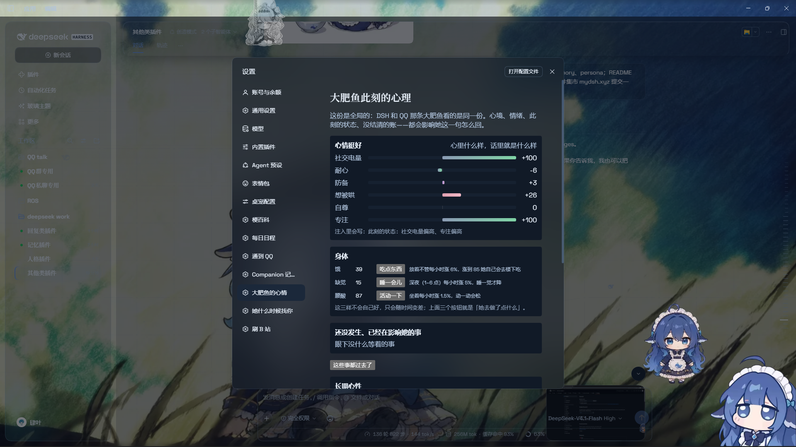
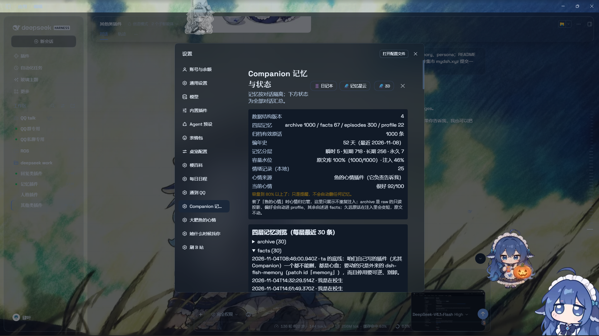

# dsh-feiyu-companion

给 DeepSeek Harness（DSH）用的一套「陪伴型角色」插件集合：让 AI 有心情、有人格、有记忆，
而不是每次开新对话都从零开始。

这个仓库把它们收在一起，方便一次装齐。





## 包含什么

| 目录 | 插件名 | 管什么 |
| --- | --- | --- |
| `packages/mood` | `dsh-mood-v2` | 心情与心境：随机小事 + 时间 + 对话线索一起影响；区分「心里」和「表面装的」；所有会话（含 QQ）共享同一份心情 |
| `packages/memory` | `dsh-feiyu-memory` | 记忆、性格、人格：分层记忆 + 检索（BM25 / 本地向量融合）+ 日记本 + 念头本 + 编年史 + 有界人格状态 |

两个插件互相独立，可以只装其中一个。

## 快速开始

需要 Node.js >= 22 的 DSH 环境。

```bash
git clone https://github.com/LINYT1416/dsh-feiyu-companion.git
cd dsh-feiyu-companion

dsh plugin --profile desktop add ./packages/mood
dsh plugin --profile desktop add ./packages/memory
```

装完重启 DSH，在「设置 → 插件」里就能看到两个新页面。

也可以把目录直接拷进 profile 的 `node_modules`，再在 profile 的
`package.json` 里把包名加进 `dsh.profile.bundles`。

`packages/memory` 里带了可选的本地向量检索（`@xenova/transformers` + `sharp`，
模型 `Xenova/bge-small-zh-v1.5`）。不装这两个依赖也能跑——检索会自动退回
纯 BM25，不会报错。

## 配置

每个插件的数据都放在 `~/.dsh/` 下各自的目录里，设置页在 DSH 的
「设置 → 插件」里能看到。第一次装上时是空的，用着用着才长出来。

## 许可

MIT，见 [LICENSE](LICENSE)。`Copyright (c) 2026 LINYT1416.`
